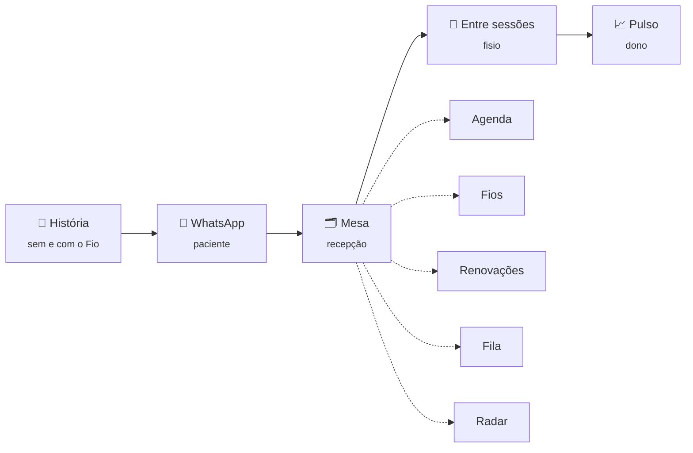

# 🧵 Fio

**O tratamento como um fio de 10 nós, para que nenhum se solte no meio do caminho.**

Protótipo navegável para a **Clínica Movimento**, feito no Desafio de Produto do PTC 26.2 do CITi

&nbsp;

&nbsp;

---

## O problema em uma frase

A Clínica Movimento perde cerca de **R$ 18,2 mil por mês** (≈ R$ 219 mil por ano) em sessões que não acontecem, e a perda não se espalha igual pelo tratamento. Ela se concentra em poucos pontos:

| Onde o fio se solta | O que acontece |
|---|---|
| **Na renovação** | Entre a 5ª e a 6ª sessão do convênio, a falta salta de **18% para 44%**: a autorização não chega a tempo e o paciente “some” na emenda. |
| **Na queda de adesão** | Depois que a dor melhora, o paciente para de ver sentido e começa a faltar. |
| **No horário de ponta** | As faixas das 7h–9h e 17h–20h concentram as faltas, e as vagas liberadas ficam vazias. |
| **No esquecimento** | A sessão simplesmente sai da cabeça. |

O Fio trata cada sessão como um **nó** de um fio contínuo. A clínica passa a enxergar onde cada fio está prestes a se soltar e age antes, em vez de só registrar a falta depois.

---

## Por onde começar

> **Sugestão de percurso (≈ 5 min):** **História** → **Mesa** → **Agenda** → **Fila** → **Pulso**

O menu no topo é o próprio fio: cada nó abre uma parte do protótipo. Em todas as telas, o botão **“Experimente”** (canto superior direito) mostra o que vale a pena testar ali.

| Parte | Para quem | O que mostra | Link direto |
|---|---|---|---|
| 📖 **História** | quem avalia | Dona Célia, o mesmo tratamento em 7 capítulos, **sem e com o Fio** | [`#historia`](https://kaio-cin.github.io/fio-clinica-movimento/#historia) |
| 💬 **WhatsApp** | paciente | As conversas que o paciente recebe, como no celular dele | [`#whatsapp`](https://kaio-cin.github.io/fio-clinica-movimento/#whatsapp) |
| 🗂️ **Mesa** | recepção | O dia da recepção: o que fazer agora, com cada tarefa explicada | [`#mesa`](https://kaio-cin.github.io/fio-clinica-movimento/#mesa) |
| 📱 **Entre sessões** | fisioterapeuta | O celular do fisio: registros rápidos entre um paciente e outro | [`#fisio`](https://kaio-cin.github.io/fio-clinica-movimento/#fisio) |
| 📈 **Pulso** | dono da clínica | O relatório do piloto (simulado), antes e depois | [`#pulso`](https://kaio-cin.github.io/fio-clinica-movimento/#pulso) |

Dentro da **Mesa** há cinco abas: [Agenda](https://kaio-cin.github.io/fio-clinica-movimento/#agenda) · [Fios](https://kaio-cin.github.io/fio-clinica-movimento/#fios) · [Renovações](https://kaio-cin.github.io/fio-clinica-movimento/#renovacoes) · [Fila](https://kaio-cin.github.io/fio-clinica-movimento/#fila) · [Radar](https://kaio-cin.github.io/fio-clinica-movimento/#radar)

---

## Experimente

Algumas interações que mostram a ideia funcionando:

- **História:** use <kbd>←</kbd> <kbd>→</kbd> para passar pelos capítulos e <kbd>T</kbd> para alternar entre **“Hoje, sem o Fio”** e **“Com o Fio”**. No capítulo 7, compare o placar dos dois finais.
- **Agenda:** clique numa sessão depois das 11h e tecle <kbd>A</kbd> (desmarcou com antecedência). A vaga vai **sozinha** para a fila. Tecle <kbd>F</kbd> (falta) e veja que ela não abre vaga: no lugar, sai a mensagem perguntando o motivo.
- **Agenda:** arraste a Dona Célia para as 7h. O Fio avisa que ela depende de carona no horário de pico.
- **Fila:** clique em **“Simular resposta”** e veja a vaga das 18h ser reocupada.
- **Renovações:** registre uma liberação de convênio e veja o cartão mudar de coluna e o fio ganhar a costura.
- **Busca:** <kbd>Ctrl</kbd> + <kbd>K</kbd> (ou <kbd>⌘</kbd> + <kbd>K</kbd> no Mac) e procure “Rita”.
- **Entre sessões:** teclas <kbd>1</kbd>–<kbd>4</kbd> para registrar, como o Paulo faria entre um paciente e outro. Depois envie o relatório da Ana Beatriz e veja a renovação dela aparecer pronta na Mesa.

---

## As quatro frentes da solução

<table>
<tr>
<td width="50%" valign="top">

### 🔁 Renovação antecipada
O pedido de renovação sai **na 2ª sessão**, não na 5ª. Isso abre cerca de **10 dias úteis** de folga até a 6ª. A aba **Renovações** acompanha cada pedido até a liberação.

</td>
<td width="50%" valign="top">

### 🧭 Virada de fase
Quando a dor melhora, o paciente recebe uma mensagem que explica **por que continuar**, montada a partir do que o próprio fisio registrou.

</td>
</tr>
<tr>
<td valign="top">

### ⏱️ Fila em ondas
Vaga liberada vai para a fila em **ondas de 3 pessoas**. Quem está em tratamento num horário ruim tem prioridade. Se a renovação atrasa, o horário é **emprestado** sessão a sessão e volta para o dono.

</td>
<td valign="top">

### 📡 Radar
Mostra quem está com risco de se soltar, **por que** está ali e qual a ação sugerida. Registra quem agiu e quando.

</td>
</tr>
</table>

<b>Regras da fila em detalhe</b>

 

| Situação | O que o Fio faz |
|---|---|
| Desmarcou com antecedência | Oferece a vaga em ondas de 3 pessoas, **30 min** cada |
| Desmarcou com menos de 24 h | Só oferece se faltarem **2 h ou mais**, em ondas de **15 min** |
| Faltou | **Não** oferece: envia a mensagem perguntando o motivo |
| Renovação atrasada | O horário é emprestado sessão a sessão e volta ao dono |

**Prioridade:** em tratamento num horário ruim → quer antecipar → ordem de chegada.

---

## Sobre os dados

> [!NOTE]
> Todos os nomes, agendas e conversas são **fictícios**, construídos a partir do caso da Clínica Movimento e das entrevistas feitas no desafio. Os números do **Pulso** simulam 3 semanas de piloto na unidade de Boa Viagem e estão marcados como simulação na própria tela.

---

## Como foi feito

- **Página única:** todo o protótipo está em um `index.html` (HTML, CSS e JavaScript juntos), publicado com o GitHub Pages.
- **React 18** carregado por CDN, sem JSX, com navegação por `#rota`. Por isso cada tela tem um link direto.
- **Estado em memória:** o que você faz numa tela (registrar uma falta, aceitar uma vaga) aparece nas outras. Ao recarregar a página, tudo volta ao início.
- **Funciona no celular**, com tema escuro e as fontes [Inter Tight](https://fonts.google.com/specimen/Inter+Tight) e [JetBrains Mono](https://fonts.google.com/specimen/JetBrains+Mono).

Para rodar localmente, basta abrir o `index.html` no navegador (com internet, por causa do React e das fontes).

---

Feito por <b>Kaio Barros</b> · Desafio de Produto · PTC 26.2 do CITi (CIn-UFPE)

